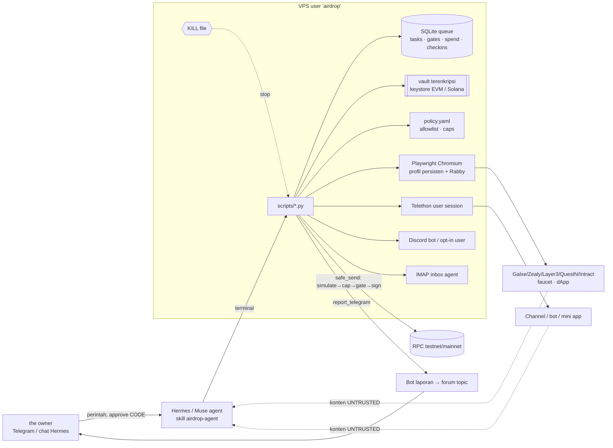

# Arsitektur & Layout



Prinsip: LLM hanya memanggil script dan membaca output JSON yang sudah di-redact. Key hanya
didekripsi di dalam proses `safe_send.py`/`siwe_sign.py`, tidak pernah lewat ke model.

## Layout

```
~/.hermes/skills/crypto/airdrop-agent/      # skill (TANPA secrets)
├── README.md  SKILL.md  LICENSE  install.sh  requirements.txt
├── references/
│   ├── workflows/        alur per jenis garapan (mermaid)
│   └── *.md              detail per kemampuan, setup, keamanan, sybil/ToS, troubleshooting
├── scripts/
│   ├── core/       common, redact, task_queue, report_telegram, checkin_runner, selfcheck, risk_mode
│   ├── wallet/     vault, chains, wallet_create, wallet_balance, safe_send, siwe_sign, sign_guard
│   ├── email/      imap_otp
│   ├── telegram/   tg_tasks
│   ├── discord/    discord_watch, chat_grinder
│   ├── web/        web_quest, browser_session, wallet_provider.js, scam_check, research_score
│   ├── testnet/    faucet_claim, testnet_daily, deploy_contract
│   └── radar/      extract, pipeline, tg_radar, x_radar, radar_runner
├── templates/   env.example, policy.yaml, projects.yaml, discord_servers.yaml, faucets.yaml, sample_chat.txt,
│                radar_sources.yaml, sample_radar_posts.txt,
│                quests/*.yaml, crontab.txt, ecosystem.config.js, systemd/*, hermes-cron-jobs.md
├── .venv/          (install.sh)
└── .venv-selfbot/  (install.sh --with-selfbot, khusus chat_grinder)

~/.airdrop-agent/                           # DATA (chmod 700)
├── .env (600)  policy.yaml  projects.yaml  discord_servers.yaml  faucets.yaml  radar_sources.yaml  quests/
├── allowlist_domains.txt  (domain di-approve / auto RISK=ON)   risk_mode.json (state RISK)
├── vault/ (700)  index.json, evm/*.json, sol/*.json, tg.session, tg_radar.session
├── data/   queue.sqlite3, radar.sqlite3, discord_grind.sqlite3, browser_token, tg_offset.json
├── browser/<profile>/   cookie login (sensitif)
├── proofs/   logs/agent.log (ter-redact), logs/risk_auto.jsonl (audit aksi RISK=ON)
└── KILL      (ada → semua berhenti)
```

Script di subfolder saling import lewat satu baris bootstrap `sys.path` di atas tiap file; panggilan antar
script memakai `common.script("nama.py")`, jadi struktur folder bebas dipindah selama nama file tetap.
