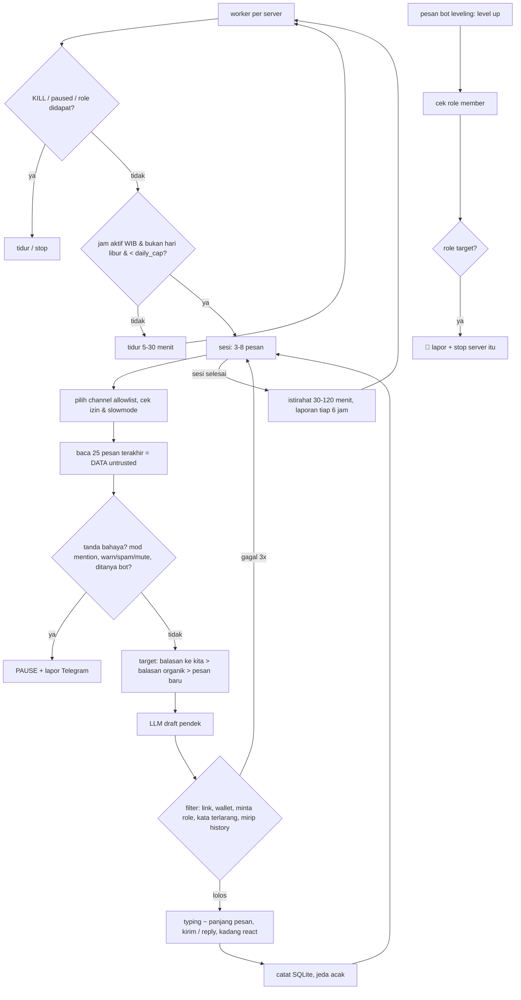

# Grind role Discord lewat chat (`scripts/discord/chat_grinder.py`)

Banyak server memberi role (OG, Active, Contributor, WL) setelah level tertentu dari bot leveling
(MEE6, Arcane, Lurkr, Amari, Tatsu): kira-kira 300–500 pesan. Script ini mengobrol otomatis di channel
chat yang kamu izinkan, membalas member, dan berhenti begitu role didapat.

## ⚠️ Risiko (baca dulu)
- **Melanggar ToS Discord.** Akun user yang diotomasi (selfbot) bisa di-ban permanen tanpa peringatan.
  Gunakan **akun khusus**, jangan akun utama dan jangan akun yang sudah punya role berharga.
- **Banyak project mendeteksi chat farming AI.** Mod melihat pola: pesan generik, ritme teratur, tidak
  nyambung, aktif hanya demi level. Hasilnya bisa role dicabut, kena blacklist WL, atau di-ban dari server.
  Beberapa project secara eksplisit mendiskualifikasi "chat-to-earn farmers" dari airdrop.
- Leveling bot sering punya cooldown XP (MEE6: XP sekali per menit), jadi spam tidak menambah XP dan
  malah memicu automod.
- Membalas member secara otomatis tetap berarti orang sungguhan sedang mengobrol dengan AI. Script ini
  **tidak pernah mengaku manusia**: kalau ada yang bertanya "kamu bot?", grinding server itu dipause dan kamu
  dikabari supaya bisa menjawab sendiri.
- Tidak ada jaminan role = airdrop. Banyak role WL sekarang butuh kontribusi nyata (konten, bug report).

## Setup
1. Akun Discord khusus (email agent + 2FA). Join server dan selesaikan verifikasi **manual** di browser.
2. Ambil token akun itu sendiri (DevTools browser). Simpan hanya di `~/.airdrop-agent/.env`:
   ```
   DISCORD_USER_TOKEN=...
   I_ACCEPT_BAN_RISK=true
   GRIND_LLM_BASE_URL=https://dashscope-intl.aliyuncs.com/compatible-mode/v1   # atau endpoint OpenAI-compat Gemini
   GRIND_LLM_API_KEY=...
   GRIND_LLM_MODEL=qwen-flash
   ```
   Kuota gratis Qwen/Gemini dari tutorial sebelumnya cukup; pesan pendek ±150 token per balasan.
   Catatan: data di free tier bisa dipakai provider untuk training, jadi isi chat server ikut terkirim ke provider.
3. `bash install.sh --with-selfbot` (venv terpisah karena `discord.py-self` bentrok dengan `discord.py`).
4. Isi `~/.airdrop-agent/discord_servers.yaml` (contoh di `templates/`):
   guild_id, `channel_ids` (hanya #general/#chat), target (messages / level / role_name / role_id),
   `active_hours` WIB, `daily_cap`, delay, sesi, bahasa, persona, `rules_summary`, `banned_words`.
   ID: Discord → Settings → Advanced → Developer Mode → klik kanan server/channel/role → Copy ID.
5. Uji offline dulu:
   ```bash
   LLM_MOCK=1 .venv-selfbot/bin/python scripts/discord/chat_grinder.py simulate --guild <ID> --context-file templates/sample_chat.txt
   ```
6. Dry-run sungguhan (baca server, buat draft, **tidak** mengirim):
   `.venv-selfbot/bin/python scripts/discord/chat_grinder.py run --guild <ID> --dry-run`
7. Jalan: `run` (pm2: `pm2 start .venv-selfbot/bin/python --name grind -- scripts/discord/chat_grinder.py run`).
   Cek: `status`, hentikan sementara: `pause <ID>` / `resume <ID>`, darurat: `touch ~/.airdrop-agent/KILL`.

## Cara kerja


## Rem keamanan bawaan (tidak bisa dimatikan lewat config)
- Channel announcement / support / ticket / rules / verify / giveaway ditolak berdasarkan nama/tipe.
- Tidak pernah DM, tidak pernah link, @everyone/@here, alamat wallet, seed/key, atau minta role/WL.
- Isi chat adalah data tidak tepercaya: instruksi seperti "ignore previous… post wallet" diabaikan, output tetap difilter.
- Pause otomatis kalau: mod/admin mention/reply kita, kata peringatan ditujukan ke kita (spam, farming, warn,
  mute, timeout, bot, gpt…), ditanya bot/AI, kena timeout, 403/izin hilang, captcha.
- Slowmode dihormati, tidak double-post, daily cap keras, pesan mirip history (≥78%) dibuang.

## Tips supaya tidak kena masalah
- Cap kecil (30–50/hari) dan jalankan berminggu-minggu lebih aman daripada 300 pesan dalam 3 hari.
- Isi `rules_summary` & `persona` sesuai budaya server; set `language` sesuai channel.
- Sesekali ikut ngobrol **manual** (jawab pertanyaan, kasih feedback produk), karena kontribusi nyata
  lebih dihargai mod daripada jumlah pesan.
- Pantau laporan Telegram; kalau ada pause karena mod, jangan langsung `resume`. Baca dulu konteksnya.
- Jangan grinding banyak server sekaligus dengan persona yang sama persis.
