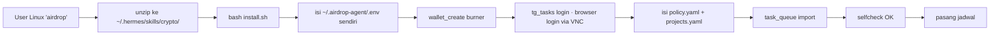

# 00 · Onboarding (sekali)

1. `sudo adduser --disabled-password airdrop && sudo -iu airdrop`
2. `unzip airdrop-agent-v2.zip -d ~/.hermes/skills/crypto/ && bash ~/.hermes/skills/crypto/airdrop-agent/install.sh`
3. `nano ~/.airdrop-agent/.env`: VAULT_PASSWORD, bot laporan, Telegram API, IMAP, RPC.
4. `$PY scripts/wallet/wallet_create.py --label main-burner` → isi saldo kecil.
5. `$PY scripts/telegram/tg_tasks.py login` (kamu sendiri, OTP).
6. Login browser (Discord, X, Galxe) via VNC: `$PY scripts/web/web_quest.py login --url https://x.com/login`.
7. Edit `policy.yaml` (RPC, cap, allowlist) & `projects.yaml` → `$PY scripts/core/task_queue.py import ~/.airdrop-agent/projects.yaml`.
8. `$PY scripts/core/selfcheck.py` harus `"ok": true` → `$PY scripts/core/report_telegram.py "agent online ✅"`.
9. Jadwal: Hermes cron (`templates/hermes-cron-jobs.md`) **atau** crontab/pm2/systemd.
