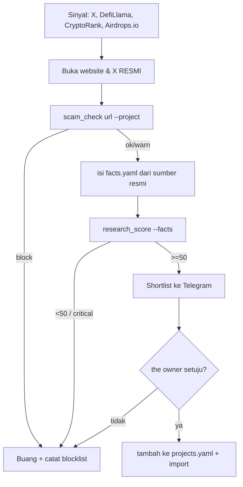

# 01 · Riset project baru

- `$PY scripts/web/scam_check.py https://app.project.xyz --project project-x`
- `$PY scripts/web/research_score.py --url https://project.xyz --official project.xyz --facts facts.yaml`
- Agent **tidak** menambah project sendiri tanpa persetujuan.
