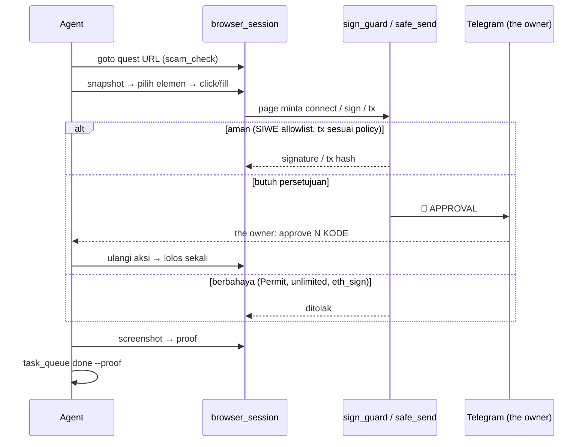

# 02 · Quest web (Galxe / Zealy / Layer3 / QuestN / Intract)

Dua mode:
- **Steps YAML (`web_quest.py`)**: quest yang langkahnya sudah jelas dan berulang.
- **Agent-driven (`browser_session.py`)**: agent membaca snapshot halaman lalu memilih klik; wallet ter-inject lewat guard.

Langkah:
1. `task_queue.py next --type web` → ambil task.
2. Steps: `$PY scripts/web/web_quest.py run --steps ~/.airdrop-agent/quests/
.yaml --task-id N`
   atau agent-driven: `serve --label main-burner --chain <c>` lalu `cmd goto/snapshot/click`.
3. Task sosial (follow/retweet) memakai profil browser yang sudah login X.
4. Captcha / KYC / Passport → `task_queue.py block N --reason captcha` → kamu selesaikan via VNC.
5. `done N --proof '{"shot":"..."}'`.
