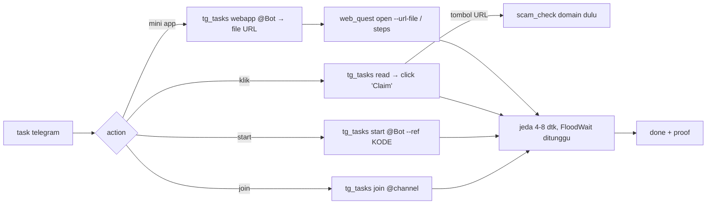

# 03 · Telegram: channel, bot referral, mini app

- Bot yang minta seed / private key / kirim token dulu → scam → `block` + lapor.
- "Connect wallet TON/EVM" di mini app → gate, jangan pakai wallet utama.
- Batas wajar: ≤20 join/hari.
