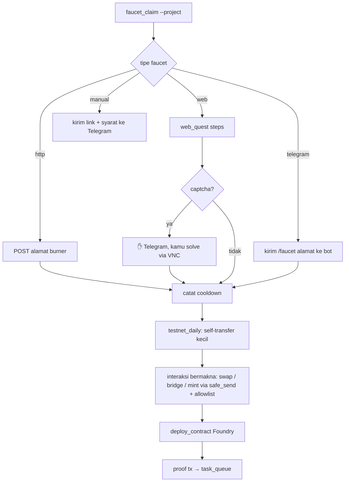

# 04 · Testnet & faucet

- Katalog faucet: `templates/faucets.yaml`. Deklarasi per project: `projects.yaml > faucets`.
- Semua tx: `scripts/wallet/safe_send.py` (simulasi, cap, allowlist; kontrak baru = gate).
- `$PY scripts/testnet/testnet_daily.py --chain sepolia --label main-burner --txs 2`
- `$PY scripts/testnet/deploy_contract.py --project-dir ~/contracts/counter --contract Counter --chain sepolia --label main-burner --broadcast`
