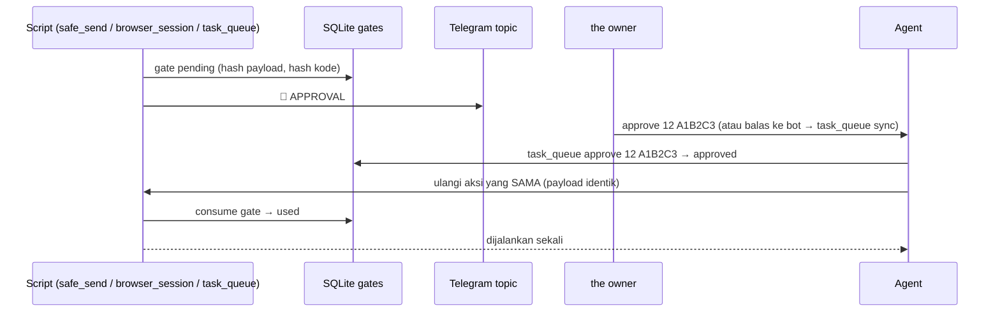

# 07 · Approval gate

- Kode hanya muncul di Telegram. Agent tidak boleh mengambil kode dari tempat lain.
- Payload berubah (nilai, tujuan, data) = gate tidak berlaku.
- Selalu gate: mainnet, > cap, kontrak baru, approve/permit, connect ke domain baru, sign non-allowlist.
- Selalu ditolak: unlimited approval, eth_sign, Permit/Permit2/Seaport di mainnet, apa pun soal seed/key.
- **RISK=ON** (`references/risk-mode.md`): gate di atas di-auto-approve dalam cap `risk_on` + label burner, kecuali
  baris "Selalu ditolak", `setApprovalForAll(true)`, dan situs claim yang gagal heuristik drainer — itu tetap gate/tolak.
  Setiap auto-approve langsung dilaporkan ke Telegram.
